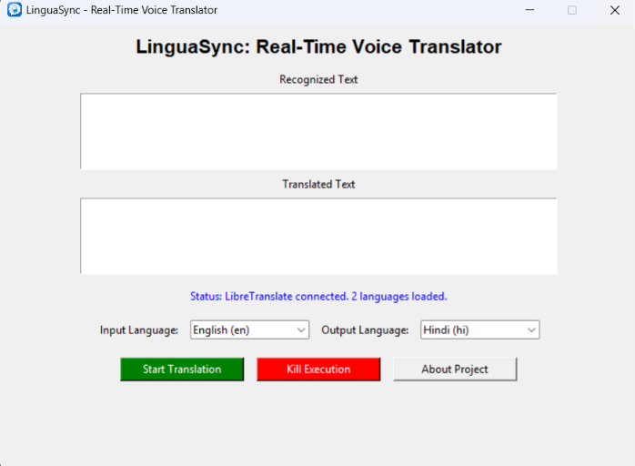
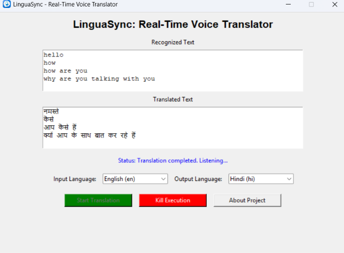
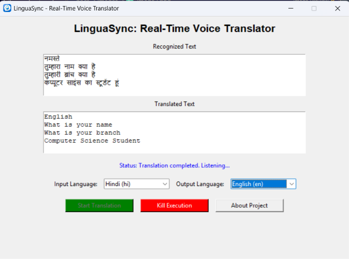

# LinguaSync: Real-Time Voice Translator

LinguaSync is a Python desktop application that captures spoken input, recognizes speech, translates the recognized text, and plays the translated speech.

## Features
- Tkinter desktop interface.
- Microphone input using PyAudio and SpeechRecognition.
- Speech recognition through Google's recognition service.
- Text translation through a local LibreTranslate API.
- Translated speech generated by gTTS and played using playsound.
- Start Translation and Kill Execution controls.
- Recognized-text and translated-text display areas.

## Screenshots

### Main interface


### English to Hindi


### Hindi to English


## Technology
Python 3.11, Tkinter, SpeechRecognition, PyAudio, LibreTranslate, Argos Translate, gTTS, playsound, Requests, cx_Freeze, and Inno Setup.

## Requirements and limitations
- Windows 10/11 64-bit is the target for the supplied Windows build.
- A working microphone and audio output device are required.
- LibreTranslate must be installed and running at `http://127.0.0.1:5000`.
- English (`en`) and Hindi (`hi`) models were confirmed in the tested setup. Other languages require their corresponding models and supported language pairs.
- Google speech recognition and gTTS require internet access. LinguaSync is therefore not fully offline.
- The desktop installer does not bundle LibreTranslate or Argos language models.

## Development setup
1. Install Python 3.11 (64-bit).
2. Create and activate a virtual environment:
   ```powershell
   python -m venv env
   .\env\Scripts\Activate.ps1
   ```
3. Install dependencies:
   ```powershell
   python -m pip install -r requirements.txt
   ```
4. Install LibreTranslate and the required Argos models separately.
5. Start the local server:
   ```powershell
   libretranslate --host 127.0.0.1 --port 5000 --load-only en,hi
   ```
6. In another terminal, run:
   ```powershell
   python main.py
   ```

## Build
```powershell
python setup.py build_exe --build-exe build\LinguaSync_Release
```
The executable is `build\LinguaSync_Release\voice-translator.exe`. Distribute the complete output directory, not only the EXE. The Inno Setup script `installer.iss` builds `dist\LinguaSync_Setup.exe`.

## Usage
1. Start LibreTranslate.
2. Launch LinguaSync.
3. Select input and output languages.
4. Click **Start Translation** and speak clearly.
5. Review the recognized and translated text and listen to the translated speech.
6. Click **Kill Execution** to request stopping.

## Repository
https://github.com/M-sahoo2007/real-time-voice-translator

## Author
Maheswar Sahoo

See `LICENSE` for license terms.
